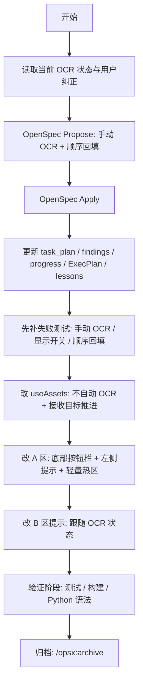
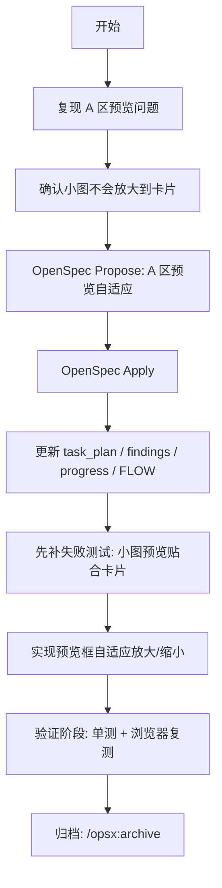
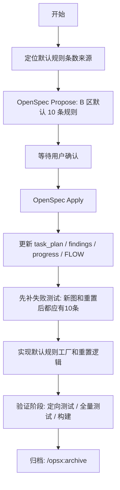
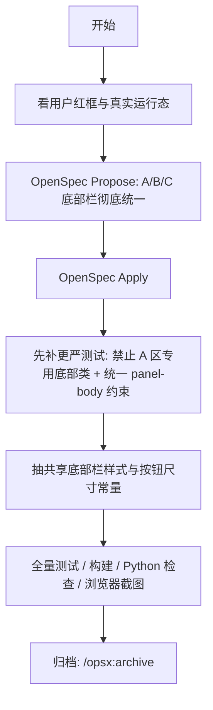
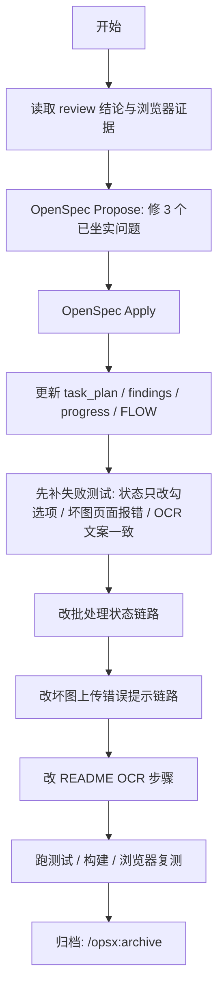
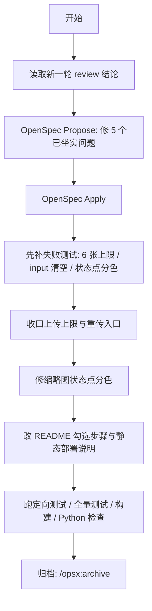
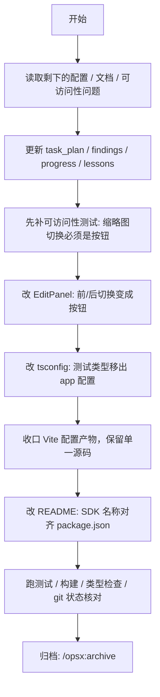
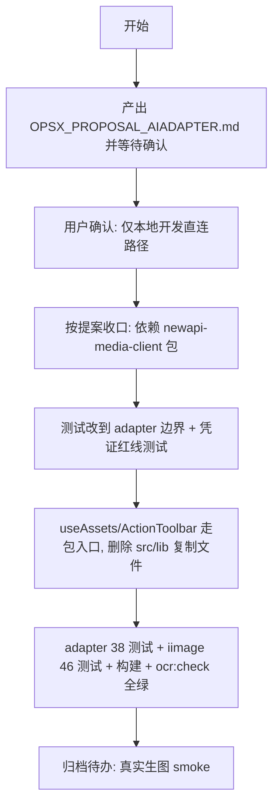

# Project Workflow (FLOW.md)

## 当前进度

- [x] 研究代码与用户纠正
- [x] /opsx:propose
- [x] /opsx:apply
- [x] 更新文档与 lessons
- [x] 失败测试
- [x] 状态层修正
- [x] A 区底部按钮栏、左侧提示与轻量热区
- [x] B 区提示修正
- [x] 测试和构建验证
- [x] /opsx:archive

## 2026-03-21 A区预览自适应修复

## 这轮进度

- [x] 复现问题
- [x] 根因定位
- [x] /opsx:propose
- [x] /opsx:apply
- [x] 更新文档
- [x] 失败测试
- [x] 实现预览修复
- [x] 测试和浏览器验证
- [x] /opsx:archive

## 2026-03-21 B区默认替换规则显示10条

## 这轮进度

- [x] 根因定位
- [x] /opsx:propose
- [x] 等待确认
- [x] /opsx:apply
- [x] 更新文档
- [x] 失败测试
- [x] 实现默认 10 条规则
- [x] 测试和构建验证
- [x] /opsx:archive

## 2026-03-21 A/B/C 底部按钮栏彻底统一

## 这轮进度

- [x] 看用户红框与真实运行态
- [x] /opsx:propose
- [x] /opsx:apply
- [x] 先补更严测试
- [x] 抽共享底部栏样式与按钮尺寸常量
- [x] 全量测试 / 构建 / Python 检查 / 浏览器截图
- [x] /opsx:archive

## 2026-03-21 修 review 发现的 3 个问题

## 这轮进度

- [x] 读取 review 结论与浏览器证据
- [x] /opsx:propose
- [x] /opsx:apply
- [x] 更新 task_plan / findings / progress / FLOW
- [x] 先补失败测试
- [x] 改批处理状态链路
- [x] 改坏图上传错误提示链路
- [x] 改 README OCR 步骤
- [x] 跑测试 / 构建 / 浏览器复测
- [x] /opsx:archive

## 2026-03-21 修 review 发现的另外 5 个问题

## 这轮进度

- [x] 读取新一轮 review 结论
- [x] /opsx:propose
- [x] /opsx:apply
- [x] 先补失败测试
- [x] 收口上传上限与重传入口
- [x] 修缩略图状态点分色
- [x] 改 README 勾选步骤与静态部署说明
- [x] 跑定向测试 / 全量测试 / 构建 / Python 检查
- [x] /opsx:archive

## 2026-03-21 修仓库整理与可访问性问题

## 这轮进度

- [x] 读取剩下的配置 / 文档 / 可访问性问题
- [x] 更新 task_plan / findings / progress / lessons
- [x] 先补可访问性测试
- [x] 改 EditPanel：前/后切换变成按钮
- [x] 改 tsconfig：测试类型移出 app 配置
- [x] 收口 Vite 配置产物，保留单一源码
- [x] 改 README：SDK 名称对齐 package.json
- [x] 跑测试 / 构建 / 类型检查 / git 状态核对
- [x] 归档: /opsx:archive

## 2026-09-06 接入 AIadapter media-adapter，移除本地复制适配器

> 以下是历史过程与当时的检查记录，不是当前发布证明。当前分支的提交审查、依赖修复和未完成的生产门槛见
> [doc/core/commit-review.md](doc/core/commit-review.md)。模型未分类时的当前开发行为见 README，不能用下面的旧拦截记录代替当前实测。

### 这轮进度

- [x] 产出提案并记录凭证决策（仅本地开发直连）
- [x] 用户确认 Yes
- [x] package.json 接入 `file:../AIadapter/media-adapter`，移除本地复制适配器
- [x] useAssets: createMediaClient + download(signal) + snapSize 留业务侧
- [x] ActionToolbar: 内存令牌 + 模型目录下拉（仅 supported_endpoint_types 分类）+ 仅本地开发标注
- [x] 启动时清除遗留 iimage-gateway 令牌；非敏感设置才落盘
- [x] 删除 src/lib/media-client.ts / media-config.ts
- [x] 测试改到 adapter 边界（createMediaClient mock，config 真实现）
- [x] adapter npm test/typecheck/build + iimage 全量测试 + 构建 + ocr:check
- [ ] 真实生图 smoke（需用户填真实网关与令牌后验证）

## 2026-09-06 真实生图冒烟结果（img.aishenji.top）

### 通过项

- [x] `GET /v1/models`：目录返回 1 个模型 `gpt-image-2`（需走系统代理 127.0.0.1:7897，终端直连 TLS 握手超时）
- [x] 真实生图：`gpt-image-2` + 提示词"one red circle centered on white background"，23s 返回结果 URL；首次请求 upstream_error、按 adapter 语义重投一次成功
- [x] 结果下载：渠道 URL 即取即存，640KB PNG（1254×1254），图像内容与提示词一致（白底红圆）
- [x] UI 测试连接：真实令牌 →「✓ 已获取 1 个模型」；无效令牌 →「✗ API Key 无效或无权限」可见
- [x] 凭证红线：令牌仅内存；localStorage 只存非敏感配置；旧版 `iimage-gateway` 令牌键在启动时被清除（UI 实测验证）
- [x] 能力分类红线：目录模型未声明 `supported_endpoint_types` → UI 显示"模型目录里没有可用的生图模型"+"1 个模型未声明生图能力"，不按 id 猜测放行

### 阻塞项（网关侧）

`gpt-image-2` 实际可生图，但 `GET /v1/models` 未返回 `supported_endpoint_types: ["image-generation"]`。
按提案"分类只信任能力声明"的规范，UI 正确拒绝把它列为生图模型 → UI 全流程生图冒烟无法执行。
解除方式二选一：① NewAPI 后台给该模型补上 image-generation 能力声明（推荐，一处配置）；
② 用户明确授权在 iimage 侧加临时白名单（违反提案红线，需要修订提案）。
