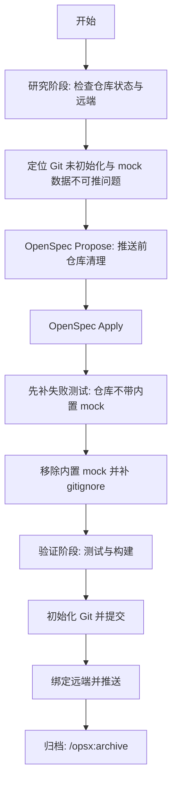

# Project Workflow (FLOW.md)

## 当前进度
- [x] 研究代码与规范
- [x] 根因定位
- [x] /opsx:propose
- [x] /opsx:apply
- [x] 失败测试
- [x] 移除内置 mock 数据
- [x] 补 gitignore 的 mock/垃圾文件规则
- [x] 测试和构建验证
- [ ] Git 初始化与推送
- [ ] /opsx:archive
