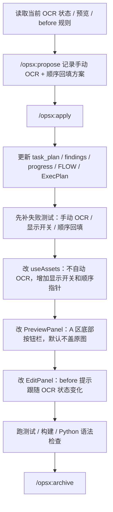
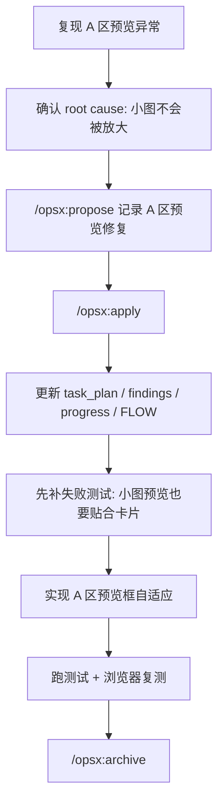
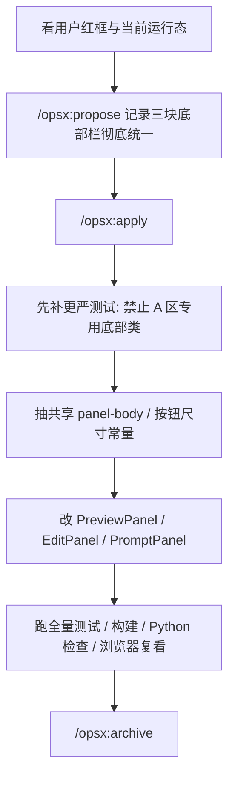
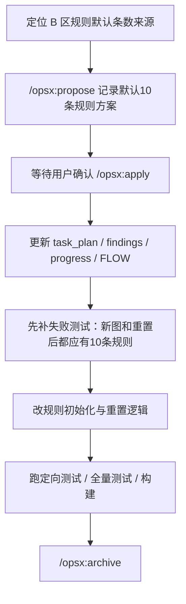
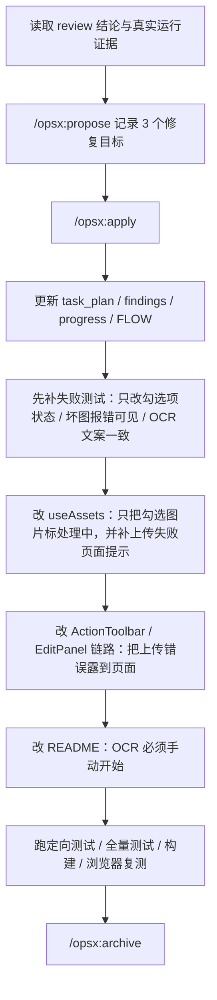
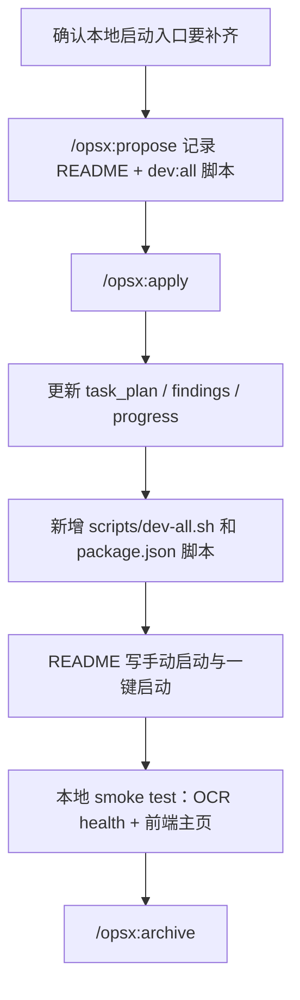
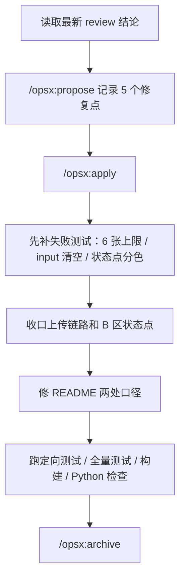
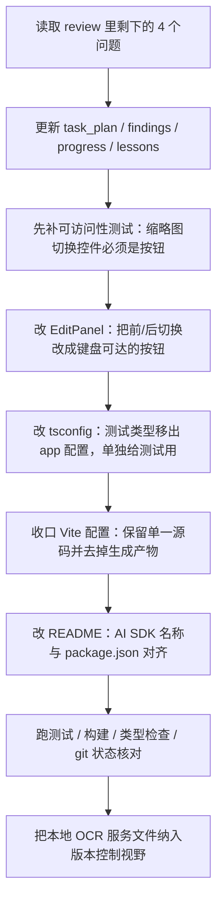

# Task Plan

## 2026-08-28 本地启动

### Goal

将 `https://github.com/ifengz/iimage.git` 克隆到 `/Users/ifengz/CodingCase/iimage`，安装前端依赖，按仓库现有脚本启动前端与本地 OCR 服务，并验证可访问地址。

### Success Criteria

- 目标目录是 Git 仓库且工作树保持可说明的状态。
- `npm install` 完成。
- OCR 健康检查和前端首页可访问；若 OCR 运行环境缺失，明确暴露具体阻塞原因。

### Result

- 已完成克隆、依赖安装、OCR 环境准备与一键启动。
- 当前访问地址：`http://localhost:5174/`。
- OCR 健康检查：`http://127.0.0.1:8787/health` 返回 `{"status":"ok"}`。

## Goal

调整 `iimage` 的 OCR 交互与回填顺序：上传图片后不再自动 OCR；A 区底部增加和 B/C 区同风格的 OCR 按钮栏，提供“开始 OCR”和“显示/隐藏 OCR”两个按钮；OCR 提示放在按钮栏左侧；OCR 框默认隐藏，避免挡住原图；点击 OCR 内容回填 `before` 时，从当前选中的 `before` 框开始，按顺序往下填，不再一直卡在第一个框。整个流程不允许使用 mock fallback，失败直接显示真实错误。

## Current Phase

Phase 5

## Flowchart

## Tasks

<task type="checkpoint">
  <name>确认这轮要修的真实问题</name>
  <files>`src/hooks/useAssets.ts`, `src/components/PreviewPanel.tsx`, `src/components/EditPanel.tsx`, `src/app.test.tsx`</files>
  <action>确认用户这轮真正不满意的是两件事：OCR 覆盖层挡住原图，以及点击 OCR 后 before 只会写进第一个框。</action>
  <verify>能明确拆出“手动 OCR + 显示开关”和“顺序回填”两条链路，而不是只改透明度。</verify>
  <done>true</done>
</task>

<task type="checkpoint">
  <name>完成 OpenSpec 规范</name>
  <files>`task_plan.md`, `findings.md`, `progress.md`, `FLOW.md`, `execplan-local-paddleocr.md`, `tasks/lessons.md`</files>
  <action>记录这轮“手动 OCR + A 区底部按钮栏 + 顺序回填”的方案，并执行 propose/apply。</action>
  <verify>`opsx propose` 和 `opsx apply` 都已记录，本地计划文档已切换到新交互目标。</verify>
  <done>true</done>
</task>

<task type="tdd">
  <name>先补 OCR 新交互测试</name>
  <files>`src/app.test.tsx`, `src/components/PreviewPanel.tsx`, `src/hooks/useAssets.ts`</files>
  <action>补测试锁住三件事：上传后不自动 OCR；A 区底部必须有两个 OCR 按钮且默认隐藏热区；点击 OCR 后回填目标会往下一个 before 框移动。</action>
  <verify>新增测试能直接指向“没有按钮 / 还在自动 OCR / 没有顺序回填”其中之一。</verify>
  <done>true</done>
</task>

<task type="auto">
  <name>调整 OCR 状态与回填顺序</name>
  <files>`src/hooks/useAssets.ts`, `src/data/mock.ts`</files>
  <action>保留 OCR 结果，但改成用户主动触发；增加 OCR 显示开关；点击 OCR 后把文字写进当前 before 框，并把接收目标自动推进到下一个 before 框。</action>
  <verify>`runCurrentOcr()` 手动触发识别；`ocrVisible` 默认是 false；连续调用回填后，多个 before 框按顺序得到文字。</verify>
  <done>true</done>
</task>

<task type="auto">
  <name>调整 A 区和 B 区交互</name>
  <files>`src/App.tsx`, `src/components/PreviewPanel.tsx`, `src/components/EditPanel.tsx`, `src/styles.css`</files>
  <action>A 区底部增加和 B/C 区同风格的按钮栏，OCR 提示放到按钮栏左侧，OCR 热区默认不显示，显示后改成轻量边框避免挡图；B 区提示文案跟着 OCR 状态走。</action>
  <verify>A 区底部能看到“开始 OCR”和“显示/隐藏 OCR”；左侧有 OCR 提示；按钮样式和 B/C 区同一套；OCR 框不再直接把识别文字盖到图上；B 区能提示下一步该点哪里。</verify>
  <done>true</done>
</task>

<task type="checkpoint">
  <name>验证并归档</name>
  <files>`progress.md`, `findings.md`, `FLOW.md`, `execplan-local-paddleocr.md`</files>
  <action>记录这轮新的测试、构建和 Python 语法检查结果，并完成 archive。</action>
  <verify>已记录新的测试口径，`opsx archive` 已落日志。</verify>
  <done>true</done>
</task>

## Key Questions

1. OCR 框挡住原图时，问题不是“颜色太深”，而是交互模型错了，必须改成默认隐藏。
2. `before` 有多行时，OCR 回填不能一直停在同一个输入框，要有“当前接收框”指针。
3. 上传后不自动 OCR，才不会让页面一上来就盖满框，用户也能自己决定什么时候识别。

## Decisions Made

| Decision | Rationale |
|----------|-----------|
| 上传后不自动 OCR | 避免一进图就被识别框盖住，用户可自己决定何时识别 |
| A 区底部固定两个 OCR 按钮 | 位置和 B/C 区按钮栏一致，视觉上更统一 |
| OCR 热区默认只显示轻量边框，不直接把识别字渲染到图上 | 减少遮挡，让原图内容还能看清 |
| OCR 回填后自动把接收目标推进到下一个 before 框 | 用户录多行时不用每次重新点输入框 |

## Notes

- 这轮不是简单改样式，是把 OCR 流程从“自动执行”改成“手动触发 + 手动显示”。
- 顺序回填只推进 `before` 框，不会改 `after` 或 `notes`。
- OCR 服务本身没有改协议，前端仍然只调 `/api/ocr`。

## Verification Results

| Command | Result |
|---------|--------|
| `opsx propose "调整 iimage 的 OCR 交互与回填顺序：A 区右上增加两个按钮，一个手动触发 OCR，一个控制 OCR 框显示/隐藏；上传图片后不再自动 OCR；OCR 框默认隐藏，避免遮挡原图；点击 OCR 内容回填 before 时，不再一直写进第一个框，而是从当前选中框开始，按 before 框顺序依次往下填；不引入 mock fallback，失败直接暴露真实错误。"` | 已记录到 `/Users/ifengz/.opsx/iimage/log.txt` |
| `opsx apply` | 已记录到 `/Users/ifengz/.opsx/iimage/log.txt` |
| `npm test -- --run src/app.test.tsx -t "manual OCR action|clicked OCR text block|moves the OCR receive target|renders clickable OCR hotzones|keeps OCR hotzones hidden|shows two OCR controls|focused before input"` | OCR 相关 7 组测试通过 |
| `npm test -- --run src/app.test.tsx -t "renders two OCR controls in the A preview bottom action bar with the same button style family"` | 按钮栏位置和样式测试通过 |
| `npm test -- --run src/app.test.tsx -t "renders the OCR hint on the left side of the A preview bottom action bar and keeps the buttons in the same size family as B/C"` | 提示位置和按钮尺寸测试通过 |
| 同上定向测试中的 `panel-body padding` 断言 | A 区底部结构测试通过 |
| `npm test -- --run` | 28 条测试通过 |
| `npm run build` | 构建通过 |
| `npm run ocr:check` | Python 语法检查通过 |
| `opsx archive` | 已记录到 `/Users/ifengz/.opsx/iimage/log.txt` |

## 2026-03-21 A区预览自适应修复

### Goal

修复 A 区图片预览：上传图片后，不管原图本身像素大还是小，都要按卡片可用空间展示；页面只改显示比例，不改图片真实尺寸。

### Flowchart

### Tasks

<task type="checkpoint">
  <name>确认问题边界</name>
  <files>`src/components/PreviewPanel.tsx`, `src/styles.css`, `src/hooks/useAssets.ts`</files>
  <action>确认问题不在上传数据本身，而在 A 区预览样式。重点核对上传后标题里显示的真实尺寸，以及图片在卡片里的实际渲染尺寸。</action>
  <verify>能证明大图会被缩进卡片，但小图会按原始 CSS 尺寸显示在中间一小块，没有被放大到卡片可用空间。</verify>
  <done>true</done>
</task>

<task type="tdd">
  <name>先补预览缩放回归测试</name>
  <files>`src/app.test.tsx`, `src/components/PreviewPanel.tsx`, `src/styles.css`</files>
  <action>先补失败测试，锁住“小图预览也要随着卡片放大展示，但标题里的真实尺寸不能变”。</action>
  <verify>新增测试先失败，而且失败点直接指向 A 区预览仍然按图片原始 CSS 尺寸渲染。</verify>
  <done>true</done>
</task>

<task type="auto">
  <name>实现 A 区预览自适应</name>
  <files>`src/components/PreviewPanel.tsx`, `src/styles.css`</files>
  <action>让 A 区预览框按卡片可用空间自动放大或缩小，并维持原始宽高比；before 和 after 共用同一套展示框。</action>
  <verify>上传小图后，A 区预览不再只显示成中间一小块；上传大图和查看 after 时也不会撑破卡片。</verify>
  <done>true</done>
</task>

<task type="checkpoint">
  <name>验证并归档</name>
  <files>`src/app.test.tsx`, `task_plan.md`, `findings.md`, `progress.md`, `FLOW.md`, `tasks/lessons.md`</files>
  <action>记录失败测试、通过测试、浏览器复测结果，补 lessons，并完成 archive。</action>
  <verify>相关测试通过，浏览器复现确认 A 区预览显示正确，OpenSpec archive 已记录。</verify>
  <done>true</done>
</task>

### Verification Results

| Command | Result |
|---------|--------|
| `opsx propose "修复 iimage A 区图片预览：上传图片后，A 区应始终显示当前上传图，并在卡片内按容器尺寸自适应展示；只调整页面展示方式，不改图片实际尺寸，也不引入 mock fallback。顺带排查当前 A 区是否拿错了预览源或被图片真实像素撑开。"` | 已记录到 `/Users/ifengz/.opsx/iimage/log.txt` |
| `opsx apply` | 已记录到 `/Users/ifengz/.opsx/iimage/log.txt` |
| `npm test -- --run src/app.test.tsx -t "scales small before previews to the card frame without changing the real size label"` | 先失败 1 条，修复后通过 |
| `npm test -- --run src/app.test.tsx` | 28 条测试通过 |
| `npm run build` | 构建通过 |
| 浏览器复测上传 `/tmp/preview-small.svg` | A 区标题仍显示 `120 × 80`，但实际展示尺寸变成约 `401 × 267`，已贴合卡片 |
| `opsx archive` | 已记录到 `/Users/ifengz/.opsx/iimage/log.txt` |

## 2026-03-21 A/B/C 底部按钮栏彻底统一

### Goal

把 A/B/C 三块面板底部按钮栏彻底收成同一套实现：A 区不再保留预览区专用底部栏类；A/B/C 的 `panel-body` 外层约束一致；A 区两个 OCR 按钮和 B/C 区按钮直接共用同一套紧凑尺寸代码。

### Flowchart

### Tasks

<task type="checkpoint">
  <name>确认这轮不是“按钮看起来像”，而是“代码真正统一”</name>
  <files>`src/components/PreviewPanel.tsx`, `src/components/EditPanel.tsx`, `src/components/PromptPanel.tsx`, `src/styles.css`, `src/app.test.tsx`</files>
  <action>确认 A 区底部栏仍保留预览区专用类，B/C 又走共享类，所以之前只是“样子接近”，不是“同一套实现”。</action>
  <verify>能明确指出 A 区还带着 `preview-actions-bar`、`preview-actions-group`、`preview-ocr-action`，而 B/C 没有。</verify>
  <done>true</done>
</task>

<task type="tdd">
  <name>先补更严底部栏测试</name>
  <files>`src/app.test.tsx`</files>
  <action>把测试抬高到结构层：A 区不能再挂预览区专用底部类；A/B/C 的 `panel-body` 都必须显式走同一套外层约束。</action>
  <verify>新增断言先失败，能直接指出“A 还残留 preview 专用类”或“B/C 外层 overflow 没统一”。</verify>
  <done>true</done>
</task>

<task type="auto">
  <name>抽共享底部栏约束和按钮尺寸</name>
  <files>`src/components/panelActionStyles.ts`, `src/components/PreviewPanel.tsx`, `src/components/EditPanel.tsx`, `src/components/PromptPanel.tsx`, `src/styles.css`</files>
  <action>把 `panel-body` 外层约束、紧凑幽灵按钮、紧凑主按钮收成共享常量；A/B/C 三块组件都直接复用；A 区去掉预览区专用底部栏类。</action>
  <verify>运行态里 A/B/C 底部栏都只走共享链路，A 区按钮尺寸和 B/C 一致。</verify>
  <done>true</done>
</task>

<task type="checkpoint">
  <name>验证并归档</name>
  <files>`task_plan.md`, `findings.md`, `progress.md`, `FLOW.md`, `tasks/lessons.md`</files>
  <action>记录这轮更严测试、全量测试、构建、Python 检查和浏览器截图结果，再完成 archive。</action>
  <verify>测试通过，浏览器上传真实图片后底部栏对齐，OpenSpec archive 已记录。</verify>
  <done>true</done>
</task>

### Verification Results

| Command | Result |
|---------|--------|
| `opsx propose "修正 iimage A/B/C 三块底部按钮栏对齐：直接按 B/C 区现有底部按钮结构统一三块面板，消除 A 区按钮偏大和 B 区按钮栏偏高的问题；要求三块面板的底部按钮栏在同一水平线，按钮高度、字号、padding、过渡与现有 B/C 区一致；不改 OCR 行为本身，只改底部按钮栏结构与样式。"` | 已记录到 `/Users/ifengz/.opsx/iimage/log.txt` |
| `opsx apply` | 已记录到 `/Users/ifengz/.opsx/iimage/log.txt` |
| `npm test -- --run src/app.test.tsx -t "renders the OCR hint on the left side of the shared A preview bottom action bar\|uses the same shared bottom action bar structure across A, B, and C"` | 先失败 2 条，修复后 2 条通过 |
| `npm test -- --run` | 31 条通过 |
| `npm run build` | 构建通过 |
| `npm run ocr:check` | Python 语法检查通过 |
| 浏览器上传 `/Users/ifengz/Antigravity_Case/001_Daily_Work/iimage/image.png` | A/B/C 底部栏对齐，A 区按钮大小与 B/C 一致 |
| `opsx archive` | 已记录到 `/Users/ifengz/.opsx/iimage/log.txt` |

## 2026-03-21 B区默认替换规则显示10条

### Goal

把 B 区“替换规则”的默认行数从现在的 1 条改成 10 条。新上传图片、替换插槽上传图片、以及重置当前图片后，都应该直接看到 10 条空白规则，减少手动连点“添加新规则”。

### Current Phase

Phase 5

### Flowchart

### Tasks

<task type="checkpoint">
  <name>确认问题边界</name>
  <files>`src/data/mock.ts`, `src/hooks/useAssets.ts`, `src/components/EditPanel.tsx`, `src/app.test.tsx`</files>
  <action>确认这轮问题不是 B 区渲染组件只显示了 1 条，而是新图片初始化时只创建了 1 条空白规则；同时确认重置当前图片时不会恢复默认规则数量。</action>
  <verify>能明确指出默认规则数量分别受“新建资产”和“重置当前图片”两条链路控制。</verify>
  <done>true</done>
</task>

<task type="checkpoint">
  <name>完成 OpenSpec 提案</name>
  <files>`task_plan.md`, `findings.md`, `progress.md`, `FLOW.md`</files>
  <action>记录这轮“B 区默认显示 10 条规则”的提案，并等待用户确认是否执行 apply。</action>
  <verify>`opsx propose` 已记录，当前还没有执行 `opsx apply`。</verify>
  <done>true</done>
</task>

<task type="tdd">
  <name>先补默认10条规则测试</name>
  <files>`src/app.test.tsx`, `src/hooks/useAssets.ts`, `src/data/mock.ts`</files>
  <action>先补失败测试，锁住两件事：新上传图片后默认有 10 条规则；重置当前图片后也恢复到 10 条空白规则。</action>
  <verify>新增测试先失败，而且失败点直接指向规则初始化或重置逻辑仍然只保留 1 条。</verify>
  <done>true</done>
</task>

<task type="auto">
  <name>实现默认10条规则</name>
  <files>`src/data/mock.ts`, `src/hooks/useAssets.ts`</files>
  <action>抽出统一的默认规则工厂，让新图片、替换插槽上传图片和重置当前图片都走同一套“默认 10 条空白规则”逻辑。</action>
  <verify>B 区首次进入编辑时直接可见 10 条规则；重置后恢复 10 条空白规则；不影响后续新增规则功能。</verify>
  <done>true</done>
</task>

<task type="checkpoint">
  <name>验证并归档</name>
  <files>`progress.md`, `findings.md`, `FLOW.md`, `src/app.test.tsx`</files>
  <action>记录这轮失败测试、通过测试和构建结果，并在完成后执行 archive。</action>
  <verify>定向测试、全量测试和构建结果都已记录，`opsx archive` 已执行。</verify>
  <done>true</done>
</task>

### Decisions Made

| Decision | Rationale |
|----------|-----------|
| 默认规则数量改为 10 条 | 用户目标是少点很多次“添加新规则”，最直接办法就是把初始空行补足 |
| 新建和重置共用同一套规则工厂 | 避免一处变成 10 条，另一处还是 1 条 |
| 先只改默认值，不改“添加新规则”按钮行为 | 这轮需求只说默认显示 10 条，没有要求限制或重做后续增删逻辑 |
| 规则工厂放到 `src/data/mock.ts` | 数据层本来就负责创建新图片对象，把默认规则一起收口最短 |

### Verification Results

| Command | Result |
|---------|--------|
| `opsx propose "调整 iimage B区默认替换规则：新上传图片和替换插槽新增图片时，B区替换规则默认直接显示10条空白规则，减少手动点‘添加新规则’；重置当前图片时也恢复到默认规则数量；不引入 mock fallback，失败直接暴露真实错误。"` | 已记录到 `/Users/ifengz/.opsx/iimage/log.txt` |
| `opsx apply` | 已记录到 `/Users/ifengz/.opsx/iimage/log.txt` |
| `npm test -- --run src/app.test.tsx -t "creates 10 empty replacement rules|restores 10 empty replacement rules"` | 先失败 2 条，修复后通过 |
| `npm test -- --run` | 31 条测试通过 |
| `npm run build` | 构建通过 |
| `npm run ocr:check` | Python 语法检查通过 |
| `opsx archive` | 已记录到 `/Users/ifengz/.opsx/iimage/log.txt` |

## 2026-03-21 修 review 发现的 3 个问题

### Goal

把这轮 review 里确认的 3 个真实问题一次修干净：批处理开始时不能把没勾选的图片一起标成“处理中”；上传坏图时页面必须直接告诉用户失败原因，不能只在控制台报错；README 里的 OCR 步骤要改成和真实页面一致，不再误导用户以为上传后会自动识别。

### Current Phase

Phase 5

### Flowchart

### Tasks

<task type="checkpoint">
  <name>确认这轮修的是 review 已坐实的 3 个问题</name>
  <files>`src/hooks/useAssets.ts`, `src/components/ActionToolbar.tsx`, `README.md`, `src/app.test.tsx`</files>
  <action>先按 review 证据收口范围：这轮不是新需求，而是修 3 个已经被代码审查和浏览器验证坐实的问题，避免顺手改别的交互。</action>
  <verify>能明确列出 3 条链路：批处理状态误伤、坏图上传无页面报错、README OCR 步骤写反。</verify>
  <done>true</done>
</task>

<task type="checkpoint">
  <name>完成 OpenSpec 提案并准备 apply</name>
  <files>`task_plan.md`, `findings.md`, `progress.md`, `FLOW.md`</files>
  <action>记录这轮“修 review 发现的 3 个问题”的规范；`opsx propose` 已执行，下一步直接进入 `opsx apply`。</action>
  <verify>`opsx propose` 已记录到 `/Users/ifengz/.opsx/iimage/log.txt`，文档已切到本轮目标。</verify>
  <done>true</done>
</task>

<task type="tdd">
  <name>先补 3 条失败测试</name>
  <files>`src/app.test.tsx`, `src/hooks/useAssets.ts`, `src/components/ActionToolbar.tsx`</files>
  <action>先补失败测试锁住三件事：开始批处理时只能改勾选图片的状态；上传坏图后页面必须出现可见错误提示；上传后默认不会自动 OCR，界面提示也必须继续引导手动点开始 OCR。</action>
  <verify>新增测试先失败，而且失败点能直接对应这 3 个问题之一，而不是测到别的东西。</verify>
  <done>true</done>
</task>

<task type="auto">
  <name>修正批处理状态和上传错误提示</name>
  <files>`src/hooks/useAssets.ts`, `src/components/ActionToolbar.tsx`, `src/components/EditPanel.tsx`</files>
  <action>把“处理中”状态只收敛到用户勾选且真正要跑的图片；同时把坏图上传、读不出尺寸这类失败改成页面直接可见，不再只炸控制台。</action>
  <verify>没勾选的图片不会被误标；坏图上传后页面能看到明确报错；用户不用开控制台也知道哪里坏了。</verify>
  <done>true</done>
</task>

<task type="auto">
  <name>修正文档 OCR 步骤</name>
  <files>`README.md`</files>
  <action>把 README 里的 OCR 步骤改成和真实页面一致：上传后不会自动 OCR，用户要手动点“开始 OCR”，识别完成后再点“显示 OCR”选字。</action>
  <verify>README 不再出现“上传后会自动 OCR”这类旧说法，步骤和当前页面提示一致。</verify>
  <done>true</done>
</task>

<task type="checkpoint">
  <name>验证并归档</name>
  <files>`progress.md`, `findings.md`, `FLOW.md`, `README.md`, `src/app.test.tsx`</files>
  <action>记录这轮失败测试、修复后测试、构建和浏览器复测结果，确认 3 个问题都收口后再 archive。</action>
  <verify>定向测试、全量测试、构建和浏览器复测结果都已记录，`opsx archive` 已执行。</verify>
  <done>true</done>
</task>

### Decisions Made

| Decision | Rationale |
|----------|-----------|
| 先只修 review 已坐实的 3 个问题 | 这轮目标已经很清楚，最短路径是先把会误导用户和会卡住页面的点收干净 |
| 上传失败必须在页面直接露出来 | 用户不会盯着控制台看；坏了就该在界面上直接说人话 |
| README 跟运行态必须同一口径 | 文档写反会把用户直接带偏，看起来像功能坏了 |
| 批处理状态只能跟着勾选集走 | 不然用户会看到“没选中的图也在跑”，判断会完全乱掉 |

### Verification Results

| Command | Result |
|---------|--------|
| `opsx propose "修正 iimage 这轮审查里发现的三处问题：1）开始批处理时，只能把用户勾选的就绪图片标成处理中，不能把没勾选的图片一起标成处理中；2）上传图片时，如果文件坏了或读不出尺寸，页面必须直接给出明确错误提示，不能只在控制台报错；3）README 的 OCR 操作说明要改成和真实页面一致：上传后不会自动 OCR，必须手动点开始 OCR。整个流程继续禁止 mock fallback，失败直接暴露真实错误。"` | 已记录到 `/Users/ifengz/.opsx/iimage/log.txt` |
| `opsx apply` | 已记录到 `/Users/ifengz/.opsx/iimage/log.txt` |
| `npm test -- --run src/app.test.tsx -t "keeps unselected ready images out of the processing state when a batch starts\|stores a page-visible error message when an uploaded file cannot be read as an image\|keeps OCR manual after upload and guides the user to click the start button first"` | 先失败 2 条，修复后 3 条通过 |
| `npm test -- --run` | 34 条测试通过 |
| `npm run build` | 构建通过 |
| `npm run ocr:check` | Python 语法检查通过 |
| 浏览器复测上传 `/tmp/bad.png` | 页面底部直接出现“无法读取图片尺寸。”，不再只剩控制台报错 |
| 浏览器复测上传 `/Users/ifengz/Antigravity_Case/001_Daily_Work/iimage/image.png` | 上传后仍然不会自动 OCR，A/B 两区都明确提示先点“开始 OCR” |
| `opsx archive` | 已记录到 `/Users/ifengz/.opsx/iimage/log.txt` |

## 2026-03-21 本地启动步骤与一键脚本

### Goal

把本地启动 OCR 服务和前端的步骤写进 README，并提供一个 `npm run dev:all` 脚本，让本机能一条命令先确保 OCR 服务可用，再启动 Vite 前端。

### Flowchart

### Tasks

<task type="auto">
  <name>新增一键启动脚本</name>
  <files>`package.json`, `scripts/dev-all.sh`</files>
  <action>添加 `npm run dev:all`，脚本先检查 OCR 健康状态，必要时拉起 OCR 服务，再启动前端。</action>
  <verify>`npm run dev:all` 能在本机把 OCR 服务和前端都起起来。</verify>
  <done>true</done>
</task>

<task type="auto">
  <name>更新 README 启动说明</name>
  <files>`README.md`</files>
  <action>把 OCR 环境准备、手动分开启动和一键启动前后端的步骤写清楚。</action>
  <verify>README 里能直接看到 `npm run ocr:server`、`npm run dev`、`npm run dev:all` 三种入口。</verify>
  <done>true</done>
</task>

<task type="checkpoint">
  <name>验证并记录</name>
  <files>`progress.md`, `findings.md`, `task_plan.md`</files>
  <action>记录 smoke test 结果，并把这次“前后端一起拉起”的结论写回 planning files。</action>
  <verify>本地 smoke test 已确认 OCR `/health` 和前端主页可访问。</verify>
  <done>true</done>
</task>

### Verification Results

| Command | Result |
|---------|--------|
| `opsx propose "补充 iimage 的本地启动说明：在 README 里写清 OCR 服务和前端分别如何启动，并增加一个本地一键脚本，能先确保 OCR 服务可用，再启动 Vite 前端；脚本不引入 mock fallback，失败直接暴露真实错误。"` | 已记录到 `/Users/ifengz/.opsx/iimage/log.txt` |
| `opsx apply` | 已记录到 `/Users/ifengz/.opsx/iimage/log.txt` |
| `npm run dev:all` | smoke test 通过，OCR 服务和前端都能拉起 |
| `curl -sS http://127.0.0.1:8787/health` | 返回 `{"status":"ok"}` |
| `curl -sS -I http://localhost:5176/` | 返回 `200 OK` |
| `opsx archive` | 已记录到 `/Users/ifengz/.opsx/iimage/log.txt` |

## 2026-03-21 修 review 发现的另外 5 个问题

### Goal

把这轮 review 里继续确认的 5 个问题收干净：顶部批量上传不能超过 B 区 6 格上限；顶部上传和空插槽上传处理完都要清空 file input，保证同一张图能马上重传；缩略图状态点不能再把就绪和处理中误画成失败；README 要补上“先勾选图片再开始生成”；README 还要明确 `dist` 不是单独扔静态站就能完整跑 OCR。

### Flowchart

### Tasks

<task type="checkpoint">
  <name>确认这轮修复范围</name>
  <files>`src/hooks/useAssets.ts`, `src/components/ActionToolbar.tsx`, `src/components/EditPanel.tsx`, `README.md`</files>
  <action>把这轮范围收口成 5 条 review 已坐实的问题，不顺手扩别的交互。</action>
  <verify>能明确列出“6 张上限、同图重传、状态点分色、勾选步骤、静态构建说明”这 5 条。</verify>
  <done>true</done>
</task>

<task type="tdd">
  <name>先补回归测试</name>
  <files>`src/app.test.tsx`</files>
  <action>补 4 条测试：顶部批量上传 7 张时只能保留前 6 张；顶部坏图失败后 input 会清空；空插槽坏图失败后 input 也会清空；缩略图状态点按真实状态分色。</action>
  <verify>4 条测试先红后绿，失败点分别对应上传上限、重传入口和状态点映射。</verify>
  <done>true</done>
</task>

<task type="auto">
  <name>收口上传和缩略图状态链路</name>
  <files>`src/data/mock.ts`, `src/hooks/useAssets.ts`, `src/components/ActionToolbar.tsx`, `src/components/EditPanel.tsx`</files>
  <action>统一 6 张上限常量；顶部上传超过上限时直接拦住并露出提示；两个上传入口处理完成后清空 input；缩略图状态点按真实状态映射颜色，并补稳定测试锚点。</action>
  <verify>顶部批量上传不会再塞出隐藏图片；坏图失败后同一张图可立即再选；就绪和处理中不再看起来像失败。</verify>
  <done>true</done>
</task>

<task type="auto">
  <name>修正文档口径</name>
  <files>`README.md`</files>
  <action>补上“先勾选图片再开始生成”，并明确 `dist` 只包含前端静态资源，生产环境仍需同源 OCR 接口或反向代理。</action>
  <verify>README 不再漏掉勾选步骤，也不会再把纯静态部署说成能完整跑 OCR。</verify>
  <done>true</done>
</task>

<task type="checkpoint">
  <name>验证并归档</name>
  <files>`src/app.test.tsx`, `README.md`, `task_plan.md`, `findings.md`, `progress.md`, `FLOW.md`</files>
  <action>记录这轮定向测试、全量测试、构建、Python 检查和 archive 结果。</action>
  <verify>4 条定向测试、38 条全量测试、构建、`ocr:check` 和 `opsx archive` 都通过。</verify>
  <done>true</done>
</task>

### Decisions Made

| Decision | Rationale |
|----------|-----------|
| 上传上限直接跟 B 区可见格子绑定 | 不让状态里再出现看不见也点不到的图片 |
| 文件 input 在 UI 层处理完就清空 | 这是“同一张图能马上重传”的最短链路 |
| 状态点只把真正失败画成失败色 | 用户不能靠一个红点去猜“是在跑还是已经炸了” |
| README 必须同时写清勾选步骤和 OCR 部署前提 | 这两条漏掉都会让用户以为按钮或 OCR 坏了 |

### Verification Results

| Command | Result |
|---------|--------|
| `opsx propose "修正 iimage 这轮 review 里确认的 5 个问题：1）顶部批量上传必须遵守 B 区 6 张上限，不能把第 7 张以后塞进看不见也删不掉的状态里；2）顶部上传和 B 区插槽上传在处理完成后都要清空 file input，保证同一张图可以立即重新上传；3）B 区缩略图右下角状态点要按真实状态分色，不能把就绪和处理中也画成失败色；4）README 的操作流程要补上‘先勾选图片再开始生成’；5）README 要明确说明构建出的 dist 不是单独扔静态站就能完整跑 OCR，仍然需要同源 OCR 接口或反向代理。继续禁止 mock fallback，失败直接暴露真实错误。"` | 已记录到 `/Users/ifengz/.opsx/iimage/log.txt` |
| `opsx apply` | 已记录到 `/Users/ifengz/.opsx/iimage/log.txt` |
| `npm test -- --run src/app.test.tsx -t "keeps top batch uploads within the visible 6 slots and reports overflow\|clears the top upload input after a failed image read so the same file can be retried\|clears the empty-slot upload input after a failed image read so the same file can be retried\|maps thumbnail status dots to the real asset states instead of painting ready work as failed"` | 先失败 4 条，修正后 4 条通过 |
| `npm test -- --run` | 38 条测试通过 |
| `npm run build` | 构建通过 |
| `npm run ocr:check` | Python 语法检查通过 |
| `opsx archive` | 已记录到 `/Users/ifengz/.opsx/iimage/log.txt` |

## 2026-03-21 修仓库整理与可访问性问题

### Goal

把这轮 review 里剩下的 4 个明显问题收干净：`tsconfig.app.json` 不能再带测试专用类型；Vite 只能保留一套真正的配置来源，不能让生成出来的 `vite.config.js` / `vite.config.d.ts` 继续和 `vite.config.ts` 并存；README 里的 AI SDK 名字要和 `package.json` 对上；B 区缩略图里切换 `before/after` 的控件要能被键盘直接操作。

### Flowchart

### Tasks

<task type="checkpoint">
  <name>确认这轮修复范围</name>
  <files>`tsconfig.app.json`, `tsconfig.node.json`, `vite.config.ts`, `vite.config.js`, `README.md`, `src/components/EditPanel.tsx`, `src/app.test.tsx`</files>
  <action>确认这轮不是继续做 OCR 交互，而是收仓库整理和可访问性问题：测试类型边界、重复 Vite 配置、README SDK 名字、缩略图切换控件的键盘可达性。</action>
  <verify>能明确指出每一条问题对应的文件和修法，不再把这轮扩成新功能。</verify>
  <done>true</done>
</task>

<task type="tdd">
  <name>先补可访问性回归测试</name>
  <files>`src/app.test.tsx`, `src/components/EditPanel.tsx`</files>
  <action>先补测试锁住缩略图里的 `前/后` 切换控件必须以 button 语义暴露出来，这样键盘用户才能直接操作。</action>
  <verify>测试先能分辨“只是个可点区域”还是“真正的按钮”。</verify>
  <done>true</done>
</task>

<task type="auto">
  <name>收口配置边界与文档命名</name>
  <files>`tsconfig.app.json`, `tsconfig.node.json`, `tsconfig.json`, `vite.config.ts`, `vite.config.js`, `vite.config.d.ts`, `README.md`</files>
  <action>把测试专用类型移出 app 配置；处理掉生成出来的多余 Vite 配置产物；README 的 AI SDK 名称改成和 `package.json` 一致的实际依赖名。</action>
  <verify>`npm run build` 仍然通过，项目里不再同时保留两套 Vite 配置真相，README 也不再写错 SDK 名字。</verify>
  <done>true</done>
</task>

<task type="checkpoint">
  <name>验证并收尾</name>
  <files>`progress.md`, `findings.md`, `FLOW.md`, `tasks/lessons.md`</files>
  <action>记录这轮配置、文档和可访问性修复的结果，并补一条 lesson，避免以后再把测试类型塞进正式 app 配置。</action>
  <verify>测试、构建、类型检查和 git 状态核对都已完成，相关文件状态符合预期。</verify>
  <done>true</done>
</task>

### Decisions Made

| Decision | Rationale |
|----------|-----------|
| 测试类型单独分层 | app 配置只管正式代码，测试边界更清楚 |
| 删除/收口多余 Vite 配置产物 | 让仓库只有一套真正的配置来源，后面不容易改串 |
| 缩略图切换改成真实按钮 | 键盘用户可以直接操作，不用额外做自定义键盘事件 |
| README 的 SDK 名称跟依赖对齐 | 避免新接手的人照着装错包 |

### Verification Results

| Command | Result |
|---------|--------|
| `git status -sb` | 确认当前还有未跟踪的本地 OCR 服务目录和若干生成文件 |
| `npm run build` | 待执行 |
| `npm run test -- --run` | 待执行 |
| `npm run ocr:check` | 待执行 |
| `git add scripts ocr_server` | 待执行 |

## 2026-09-05 接入 AIadapter 启动阶段

### Goal

调研将 iimage 接入 `/Users/ifengz/CodingCase/AIadapter/media-adapter` 的最小必要路径，并移除 iimage 现有官方直连实现；当前阶段只完成 OpenSpec propose，禁止修改业务代码、禁止修改 AIadapter。

### Success Criteria

- `lessons.md` 已完整读取。
- `task_plan.md`、`progress.md`、`findings.md` 均位于 `doc/core/`，根目录无同名过程文件。
- `.gitignore` 明确排除过程文件、`doc/test/` 和现有本地/mock 数据路径。
- OpenSpec propose 可执行并产出规范；在 propose 完成前不进入 apply 或业务实现。

### Current Phase

Phase 0: OpenSpec propose / 等待明确 `Yes`

### Scope Boundary

- 允许：读取项目规则与过程文档，检查路径和忽略规则，记录 OpenSpec propose 结论。
- 禁止：读取或修改业务实现代码，执行 `/opsx:apply`，修改 `/Users/ifengz/CodingCase/AIadapter`，创建分支或 worktree。

### OpenSpec Entry

项目内未发现 OpenSpec 配置目录或 shell/npm 命令定义；这不能用来判定 Codex slash 工作流不可用。下一步应在当前 Codex 会话中执行 `/opsx:propose <需求描述>`，提案产出后等待用户明确回复 `Yes`；未确认前禁止 `/opsx:apply`、移除直连实现或其他业务实现。

## 2026-09-05 用户澄清后的接入边界

### Current Status

用户已完成适配层范围确认；目标源为 `/Users/ifengz/CodingCase/AIadapter/media-adapter`，并要求移除 iimage 现有官方直连实现。当前仍不得据此进入业务实现或执行 apply。

### Confirmed Facts

- iimage 当前已是浏览器直连 NewAPI 风格的 `/v1/images/generations`。
- AIadapter HEAD 是 Portkey Gateway 1.15.2，需要 `x-portkey-provider` 与 `x-portkey-config`，且没有 `video` / `supported_endpoint_types`。
- iimage 现有官方直连实现不属于保留范围，后续提案必须明确其移除边界；本阶段不读取、不修改该业务实现。

### Next Action

下一步仅执行 `/opsx:propose <需求描述>`；提案产出后等待用户明确回复 `Yes`，在此之前不执行 `/opsx:apply`，不修改业务代码，不修改 AIadapter。
