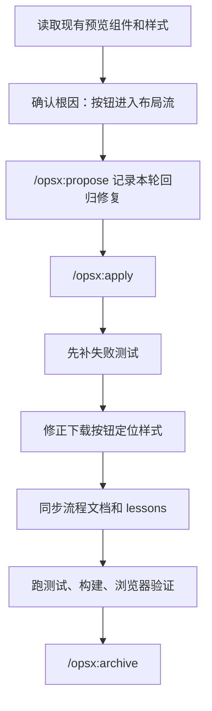

# Task Plan

## Goal

修复 A 区 after 预览 hover 下载按钮错位，让按钮真正悬浮在图片右上角，不再把 after 图本体挤偏。

## Current Phase

Phase 5

## Flowchart

## Tasks

<task type="checkpoint">
  <name>确认下载按钮错位的真实根因</name>
  <files>`src/components/PreviewPanel.tsx`, `src/styles.css`, `src/app.test.tsx`</files>
  <action>确认下载按钮为什么没有悬浮在图片右上角，以及 after 图为什么会跟着偏位。</action>
  <verify>能明确指出 `.preview-download-button` 的 `position: absolute` 被后面的 `.button { position: relative; }` 覆盖，按钮进入了 flex 布局流，顺手把图片挤偏。</verify>
  <done>true</done>
</task>

<task type="checkpoint">
  <name>完成 OpenSpec 规范</name>
  <files>`task_plan.md`, `findings.md`, `progress.md`, `FLOW.md`</files>
  <action>记录这轮“修复 after 预览下载按钮错位”的方案，并执行 propose/apply。</action>
  <verify>`opsx propose` 和 `opsx apply` 都已记录，本地流程文件已经切到当前回归问题。</verify>
  <done>true</done>
</task>

<task type="tdd">
  <name>先补下载按钮布局回归测试</name>
  <files>`src/app.test.tsx`, `src/styles.css`, `src/components/PreviewPanel.tsx`</files>
  <action>先写会失败的测试，锁住“after 预览的下载按钮必须是悬浮层，不能参与布局”，并补上键盘聚焦入口。</action>
  <verify>新增测试先失败，而且失败原因正是按钮悬浮层丢失、预览区不能先拿到焦点。</verify>
  <done>true</done>
</task>

<task type="auto">
  <name>最小实现预览悬浮层修复</name>
  <files>`src/styles.css`, `src/components/PreviewPanel.tsx`</files>
  <action>把下载按钮重新锁回图片右上角悬浮层，并让预览区本身可以先拿到焦点，避免看不见的按钮被键盘直接选中。</action>
  <verify>after 图 hover 时按钮显示在右上角；按钮不再占布局位置；after 图重新居中；键盘先到预览区，再到下载按钮。</verify>
  <done>true</done>
</task>

<task type="checkpoint">
  <name>验证并归档</name>
  <files>`progress.md`, `findings.md`, `FLOW.md`, `tasks/lessons.md`</files>
  <action>记录测试、构建、浏览器验证结果，更新流程图和 lessons，并完成 archive。</action>
  <verify>已记录一次失败测试、一次通过测试、一次全量测试、一次构建验证、一次本地服务可用性检查和一次 archive 记录。</verify>
  <done>true</done>
</task>

## Key Questions

1. 用户要的是右上角悬浮按钮，不是额外占一列的按钮。
2. after 图位置变化和下载按钮是同一个根因，不需要拆成两次修。

## Decisions Made

| Decision | Rationale |
|----------|-----------|
| 这轮只做最小回归修复 | 问题已经定位到单一悬浮层回归，不需要顺手改别的结构 |
| 先用测试锁住悬浮层和键盘入口 | 这次坏掉的不只是位置，还有看不见按钮被键盘选中的问题 |
| 文档和流程图单独开一轮记录 | 用户这次是在纠正上一个改动，必须留痕避免重复犯错 |

## Errors Encountered

| Error | Attempt | Resolution |
|-------|---------|------------|
| 当前目录不是 git 仓库，不能用 `git status` 看变更 | 1 | 本轮继续只基于文件内容和验证命令推进 |

## Notes

- 先失败测试，再写实现
- 这轮不碰生成逻辑和状态点逻辑，只修预览下载悬浮层
- 改完后同步更新 `FLOW.md` 和 `tasks/lessons.md`
- 这轮浏览器验证直接看了真实坐标和定位结果，不再用 `curl` 代替视觉验证

## Verification Results

| Command | Result |
|---------|--------|
| `opsx propose "修正 A 区 after 预览 hover 下载按钮错位；查清并修正 after 图位置被带偏的问题，确保按钮出现时不挤压、不改变图片位置，只作为悬浮层覆盖在预览右上角。"` | 已记录到 `/Users/ifengz/.opsx/iimage/log.txt` |
| `opsx apply` | 已记录到 `/Users/ifengz/.opsx/iimage/log.txt` |
| `npm test -- --run src/app.test.tsx -t "keeps the after preview download button as an overlay instead of letting it join layout"` | 先失败 1 条，证明按钮悬浮层丢失 |
| `npm test -- --run src/app.test.tsx -t "lets keyboard users focus the after preview before revealing the download button"` | 先失败 1 条，证明预览区没有键盘入口 |
| `npm test -- --run src/app.test.tsx` | 20 条测试通过 |
| `npm test -- --run` | 20 条测试通过 |
| `npm run build` | 构建通过 |
| 浏览器实测 `getBoundingClientRect()` | 修复后按钮 `position` 为 `absolute`，位于 A 区右上角；图片仍居中 |
| `opsx archive` | 已记录到 `/Users/ifengz/.opsx/iimage/log.txt` |
